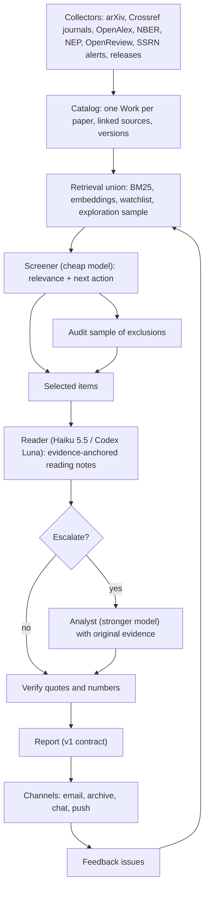

# Architecture

Lark is a scheduled research pipeline with persistent memory. Its main job is to decide
how much attention, and how much computation, each new item deserves:

**collect broadly → find potentially relevant work → read selected items → check
consequential claims → produce a short briefing.**



## Stages

| Stage | Module | Uses a model? | Notes |
|---|---|---|---|
| Collect | `lark/sources/` | No | Each source keeps a checkpoint and reports `ok`, `empty`, `failed`, `partial`, or `stale`. Retrieval windows overlap; reconciliation runs periodically. Per-host rate limits are shared (arXiv: one request per 3 s). |
| Catalog | `lark/catalog/` | No | Merges by exact identifiers (DOI, arXiv, SSRN, OpenReview, RePEc). Title/author similarity only *proposes* a merge. Revisions are classified as trivial, substantive, or withdrawn before anything is re-read. |
| Retrieve | `lark/screen/retrieve.py` | Embeddings only | The **union** of lexical, embedding, watchlist, and exploration routes, so recall isn't lost to any single method. |
| Screen | `lark/screen/screener.py` | Cheap (Gemini Flash) | A short JSON verdict: topics, priority, next action, reason, missing information. A missing abstract gives `insufficient_info`, not "irrelevant". |
| Read | `lark/read/` | Reader role | Full text is fetched only after selection (arXiv HTML first, then PDF via GROBID or PyMuPDF). Prompts are derived from the finch reading skill. |
| Verify | `lark/read/verify.py` | No | Each quote is checked against the parsed source text, and numbers against their context. |
| Analyze | `lark/analyze/` | Analyst role | Gets a specific question plus the original passages, never a cheap model's summary. |
| Brief | `lark/pipelines/` + `lark/report/` | Composer role | Builds a `Report`: at most 8 items, and zero is allowed. Weekly synthesis and deep reads use the same contract. |
| Deliver | `lark/report/channels/` | No | See [channels.md](channels.md). |
| Learn | `lark/feedback/`, `lark/eval/` | No | Feedback issues become labels. Evaluation measures recall, precision, faithfulness, and cost per useful item. |

## Reading depths

The report always says how much was read. "Full text obtained" is not "full paper read".

| Depth | Material | What it may claim |
|---|---|---|
| `abstract` | Title + abstract | Relevance, and what the authors say they propose |
| `focused` | The relevant sections and supporting results | The inspected claims, with their conditions |
| `full` | Main text, exhibits, relevant appendices | The paper's argument and evidence as a whole |
| `technical` | Derivations, comparisons, reproduction as needed | A deeper assessment, stating what was checked |

Claims are tagged as *paper result* or *authors' interpretation*. A connection to your
research is always labeled **Lark's inference**.

## Model roles and routes

Roles (`screener`, `reader`, `analyst`, `composer`, `local_*`) are kept separate from the
concrete routes that serve them (`lark/defaults.yaml`):

| Route | Worker | Billing |
|---|---|---|
| `gemini_flash` | Gemini API key | Google AI Pro developer credit |
| `claude_haiku`, `claude_sonnet` | `claude -p` (official CLI) | Claude subscription (Enterprise seat; policy to be confirmed) |
| `codex_luna`, `codex_sol` | `codex exec` (official CLI) | ChatGPT Pro subscription |
| `local_gemma` | OpenAI-compatible endpoint (Ollama on the 4090) | Local |

A role lists routes with a strategy: `fallback` tries them in order; `alternate` spreads
jobs across them, which also gives paired comparisons of the two readers. Every output
records its provider, model, route, billing, and usage.

## Budgets

There are two budgets, both enforced in code rather than in prompts:

- **Cash.** Each metered call is reserved in the ledger before dispatch and settled
  afterwards. The monthly cap defaults to the $10 Gemini credit, and the paid fallback
  is $0.
- **Subscription capacity.** No reliable remaining-quota counter exists, so each route
  has a daily call cap. Rate-limit and auth failures are recorded and trigger fallback.

Over-limit work is **deferred** in the persistent job queue, never dropped. The report
footer shows spending, route health, and the backlog.

## State

```
lark-data/
  data/YYYY/MM/DD/<kind>.<writer>.jsonl   append-only log (works, source_records, screenings,
                                          readings, analyses, jobs, ledger, deliveries, feedback, ...)
  .cache/index.sqlite                     rebuilt from the logs; never committed
  cache/fulltext/                         parsed text of read papers
  briefings/YYYY/<report_id>.{md,json}
```

Keyed records (works, jobs, checkpoints) keep their latest snapshot. Everything else is
an event. The writer suffix (`main` for hosted runs, `gpu` for the workstation) means
concurrent writers never touch the same file, so git rebases stay clean.

## Code and data separation

- **`iamsikun/lark` (public):** code, defaults, templates, docs. It contains nothing personal.
- **`iamsikun/lark-data` (private):** profiles, journal registry, watchlist, state, briefings,
  feedback, and the workflows. The workflows live here so that run logs are private too.

Source material is treated as data. Readers run with tools disabled, so text from a PDF
or README cannot make a worker run code or spend money.
